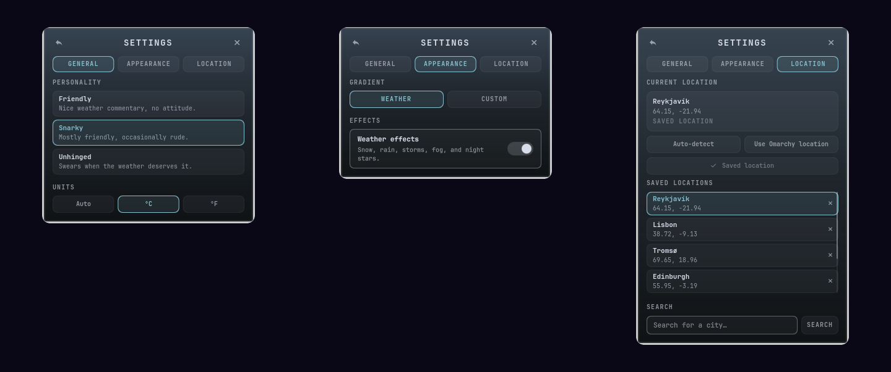

# Statusphere

A weather widget for the Omarchy bar with a Carrot-style hero, a 3-day
forecast, and opinions about the weather.




- Bar button: current condition glyph + temperature, with a hover tooltip.
- Popup: location, large icon + temperature, `FEELS` line, a weather comment,
  humidity / wind / rain tiles, a 3-day forecast, and a footer with the last
  update time and refresh. The cog opens a settings page with **General**
  (personality and units), **Appearance** (gradient and effects), and
  **Location** tabs.
- Effects: weather particles in the popup only — snow, rain, thunderstorms
  with a lightning flash, drifting fog, twinkling stars at night
  (21:00–06:00), fireworks on New Year's Day and Bonfire Night, and a meteor
  shower on April Fools' Day. The bar button stays clean.
- Data: [Open-Meteo](https://open-meteo.com/) (no API key).
- Location: a custom location saved by Statusphere takes precedence, then the
  shared `~/.local/state/omarchy/settings/weather.json` the rest of Omarchy
  uses. If neither has coordinates, Statusphere geocodes the saved name, then
  falls back to `https://geo.omarchy.org/`. The Location tab can auto-detect
  once, search for a place by name, and keep a short list of saved locations
  to switch between.
- Cache: the last good response is kept in
  `~/.cache/naoko.statusphere/report.json` and shown (marked stale) if a refresh
  fails.

## Install

```bash
omarchy plugin add https://github.com/r8tten/statusphere.git --enable
omarchy restart shell
```

`--enable` turns Statusphere on and asks where to put it in the bar; the default
is the right side. Add `--yes` to accept the default without the prompt.

Requirements: Omarchy with Quickshell, and `curl`.

## Update

```bash
omarchy plugin update naoko.statusphere
omarchy restart shell
```

## Remove

```bash
omarchy plugin remove naoko.statusphere
omarchy restart shell
```

Removing the plugin leaves your settings in
`~/.local/state/naoko.statusphere/settings.json`; delete that file as well for a
clean slate.

## Settings

Defaults are read from the widget's entry in `shell.json`, and Omarchy's
settings panel can edit the same keys through this plugin's `schema`. The
in-popup settings page overrides tone, units, and appearance locally.

| Key | Type | Default | Meaning |
| --- | --- | --- | --- |
| `tone` | `friendly` / `snarky` / `unhinged` | `snarky` | How much attitude the comment gets. |
| `unit` | `auto` / `metric` / `imperial` | `auto` | `auto` follows the locale. The General tab's units control overrides it and remembers the choice. |
| `refreshMinutes` | integer (5–120) | `15` | How often to refetch Open-Meteo. |

Example entry:

```json
{ "id": "naoko.statusphere", "tone": "unhinged", "unit": "metric", "refreshMinutes": 15 }
```

The comment rerolls when the panel opens, when the weather refreshes, when you
click it, or when you pick a different tone, fading the old line out and the new
one in when **Comment fade** is on. Tone only affects the popup comment; the bar
tooltip stays plain. Comments come from a pack for the current weather, with
separate friendly, rude, and profane lines. On 24–26 December, 31 December–1
January, 31 October, and 1 April, a holiday pack (Christmas, New Year,
Halloween, April Fools) takes over for the day.

The cog in the popup opens the settings page. **General** holds the personality
and unit choices. **Appearance** controls the popup's gradient and weather
effects. **Location** shows the active source and lets you auto-detect once,
return to Omarchy's location, or search for a place by name. **Save this
location** pins the current place to a saved list you can switch between;
removing the active saved location falls back to Omarchy's. Tab and Shift+Tab
cycle the three tabs; closing the popup returns the page to General.

### Appearance

The gradient follows the theme accent by default, nudged by the current
condition (**Weather**). Switch to **Custom** to pick your own hue and
vividness with two sliders; the first switch seeds them from the current
weather gradient, then your values are remembered. Custom keeps the theme's
accent lightness, so the popup still belongs to the desktop, and the vividness
slider also deepens the wash so higher values carry more colour down the card.

**Weather effects** is a single on/off switch for all particles. They only
appear in the popup, are paused while the settings page is open, and stop when
the popup closes:

| When | Effect |
| --- | --- |
| Snow | Snowflakes of varied sizes drifting down with a gentle sway. |
| Rain | Thin, slanted streaks falling fast. |
| Thunderstorm | Rain plus an occasional lightning flash. |
| Fog | Slow, translucent puffs drifting across. |
| Night (21:00–06:00) | Twinkling stars, unless rain, snow, fog, or a thunderstorm overrides them. |
| New Year's Day, Bonfire Night (5 Nov) | Fireworks bursting in the popup. |
| April Fools' Day (1 Apr) | A meteor shower streaks across the popup. |

Stars follow your local clock rather than the API's sunrise/sunset flag, so they
turn on at 21:00 and off at 06:00 year-round. Any weather effect takes priority
over them. Fireworks and the meteor shower replace the weather effect for the
day.

**Comment fade** controls whether a new comment fades in, or swaps over
instantly. It is on by default.

Effects and comment fade are on by default. Neither the gradient nor these
preferences are written to `shell.json`; they live in the plugin's own state
file.

Picking a tone, changing units, choosing a location, saving or removing a
saved location, or changing appearance writes only this plugin's own state
file:

```
~/.local/state/naoko.statusphere/settings.json
```

It looks like:

```json
{
  "tone": "unhinged",
  "unit": "metric",
  "appearance": {
    "gradient": "custom", "hue": 205, "sat": 82,
    "effects": true, "commentFade": true
  },
  "location": { "name": "Reykjavík", "latitude": 64.1466, "longitude": -21.9426 },
  "locationSource": "manual",
  "favourites": [
    { "name": "Reykjavík", "latitude": 64.1466, "longitude": -21.9426 },
    { "name": "Lisbon", "latitude": 38.7167, "longitude": -9.1333 }
  ]
}
```

Those values take precedence over the corresponding settings from then on.
`appearance.gradient` is `weather` or `custom`; `hue` (0–360) and `sat`
(0–100) are kept only once a custom gradient has been seeded. `effects` and
`commentFade` are booleans and default to on. `locationSource` is `manual` or
`auto`; omit `location` to follow Omarchy's shared location again. `favourites`
holds up to 20 saved places, deduplicated by coordinates, and survives **Use
Omarchy location**; removing the active saved location also clears `location`,
so Statusphere falls back to Omarchy's. Delete the file to fall back to the
configured defaults. Statusphere never writes to `~/.config/omarchy/shell.json`
or to Omarchy's shared `weather.json`.

## Files

| File | Purpose |
| --- | --- |
| `manifest.json` | Plugin metadata and settings schema. |
| `Panel.qml` | Bar button, popup, fetch/location/cache logic, settings page. |
| `Effects.qml` | Weather particles: snow, rain, storm flash, fog, night stars. |
| `Model.js` | Open-Meteo parsing, validation, icons, units, mood hue, effect kind. |
| `Snark.js` | Comment packs for each weather category and tone. |

## Notes

- API responses are validated before use; a malformed payload is ignored rather
  than shown.
- Network calls use `curl` through Quickshell's `Process`, with timeouts and a
  response-size cap.
- All API text is rendered as `Text.PlainText`.
- Weather data by [Open-Meteo](https://open-meteo.com/) (CC BY 4.0).

## License

MIT. See [LICENSE](LICENSE).
