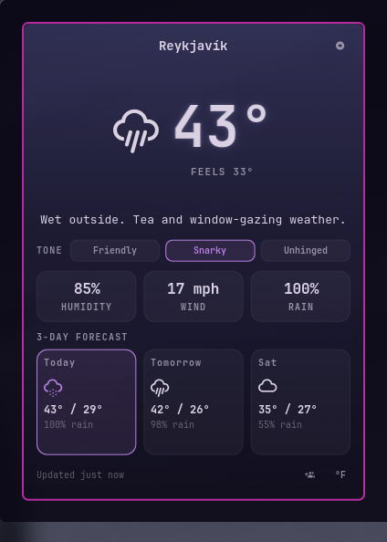

# Statusphere

A weather widget for the Omarchy bar with a Carrot-style hero, a 3-day
forecast, and opinions about the weather.



- Bar button: current condition glyph + temperature, with a hover tooltip.
- Popup: location, large icon + temperature, `FEELS` line, a weather comment,
  a Friendly / Snarky / Unhinged tone selector, humidity / wind / rain tiles,
  a 3-day forecast, and a footer with the last update time, refresh, and a
  session-only °C/°F toggle.
- Data: [Open-Meteo](https://open-meteo.com/) (no API key).
- Location: the same `~/.local/state/omarchy/settings/weather.json` the rest of
  Omarchy uses. If it has no coordinates, Statusphere geocodes the saved name,
  then falls back to `https://geo.omarchy.org/`.
- Cache: the last good response is kept in
  `~/.cache/naoko.statusphere/report.json` and shown (marked stale) if a refresh
  fails.

## Install

```bash
git clone https://github.com/r8tten/statusphere.git \
  ~/.config/omarchy/plugins/naoko.statusphere
```

Then add **Statusphere** to the bar from the Omarchy bar settings. Do not add it
by hand unless you already edit `~/.config/omarchy/shell.json`.

Requirements: Omarchy with Quickshell, and `curl`.

## Settings

Settings are read from the widget's entry in `shell.json`. The settings panel
uses this plugin's `schema`, so the same keys can be changed there.

| Key | Type | Default | Meaning |
| --- | --- | --- | --- |
| `tone` | `friendly` / `snarky` / `unhinged` | `snarky` | How much attitude the comment gets. |
| `unit` | `auto` / `metric` / `imperial` | `auto` | `auto` follows the locale. The panel's °C/°F button overrides it for the current session only. |
| `refreshMinutes` | integer (5–120) | `15` | How often to refetch Open-Meteo. |

Example entry:

```json
{ "id": "naoko.statusphere", "tone": "unhinged", "unit": "metric", "refreshMinutes": 15 }
```

The comment rerolls when the panel opens, when the weather refreshes, when you
click it, or when you pick a different tone. Tone only affects the popup
comment; the bar tooltip stays plain.

Picking a tone in the panel writes only this plugin's own state file:

```
~/.local/state/naoko.statusphere/settings.json
```

It looks like `{ "tone": "unhinged" }` and takes precedence over the `tone`
setting from then on. Delete that file to fall back to the configured default.
Statusphere never writes to `~/.config/omarchy/shell.json`.

## Files

| File | Purpose |
| --- | --- |
| `manifest.json` | Plugin metadata and settings schema. |
| `Panel.qml` | Bar button, popup, fetch/location/cache logic. |
| `Model.js` | Open-Meteo parsing, validation, icons, units, mood hue. |
| `Snark.js` | Comment packs for each weather category and tone. |

## Notes

- API responses are validated before use; a malformed payload is ignored rather
  than shown.
- Network calls use `curl` through Quickshell's `Process`, with timeouts and a
  response-size cap.
- All API text is rendered as `Text.PlainText`.
- Weather data by [Open-Meteo](https://open-meteo.com/) (CC BY 4.0).

## License

MIT. See [LICENSE](LICENSE).
